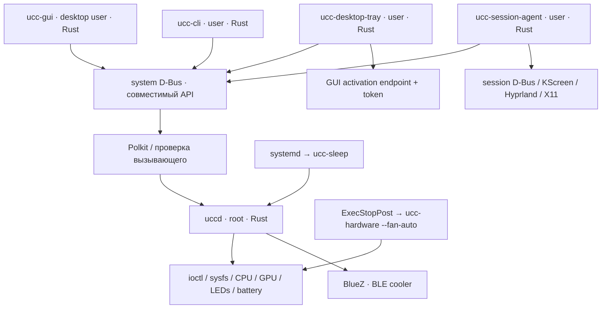

# Полный переход Frixit Control Center на Rust

Дата: **7 ноября 2026 года**. Статус: **план реализации после изучения текущего проекта; переписывание ещё не начато**.

База сохранена и отправлена в `origin/codex/frixit-control-center`: [`45921b0`](https://github.com/Frixlt/UCC/commit/45921b0b7021448a81575a840b2b77d93da8b298). Этот коммит включает все 42 изменённых и новых файла, существовавших перед подготовкой плана. Исторический `ControlCenter-Python` чистый, commit `ba6fd4a`.

Связанные материалы:

- [Исполняемое задание для Gemini: четыре роли 2+2, этапы, тесты и реестры](GEMINI_START_HERE.md). Это дополнение по организации реализации и полной проверке, подготовленное по отдельному указанию пользователя.
- [Инвентаризация компонентов, файлов, 122 D-Bus-методов и 7 сигналов](BASELINE_INVENTORY.md).
- [Машиночитаемый манифест исходной базы с SHA-256](baseline-manifest.json).
- [Текущие правила сборки](../BUILDING.md), [проверки и известные ограничения](../TESTING.md), [происхождение проекта](../../PROJECT_ORIGINS.md).

## 1. Результат, к которому идём

Переписать весь собственный прикладной центр на Rust: системный демон, аппаратные контроллеры, политики, хранение настроек, IPC-клиент, CLI, графический интерфейс, самостоятельный трей, session agent, sleep/helper-программы, импортеры и используемые инструменты сопровождения. Финальная поставка основного приложения не должна зависеть от старых исполняемых Python/C++-компонентов, Qt Widgets или `libucc-dbus.so`.

Переход считается завершённым по возможностям и проверкам, а не по факту появления Rust-окна. Временный мост к старому демону допустим на промежуточном этапе, но не является конечной архитектурой.

Приложение остаётся Linux control center. Ядро Linux, отдельный `tuxedo-drivers`/DKMS, BlueZ, systemd, Polkit, графические драйверы и поставляемые NVIDIA библиотеки остаются внешними системными компонентами. «Весь центр на Rust» не означает переписывание ядра, драйверов или каждого транзитивного системного компонента.

Архив Python используется как первоисточник поведения и входных форматов. Его собственный HTTP/FastAPI/Unix socket/SSE API не восстанавливаем: текущие интеграции UCC используют D-Bus.

### Особая граница GNOME и Plasma

В проекте есть самостоятельный трей и отдельно два встраиваемых интерфейса: GNOME Shell extension на GJS и Plasma applet на QML с C++ backend. Их нельзя честно объявить «переписанными на чистый Rust», просто оставив `extension.js` и QML.

Для полного плана фиксируем два проверяемых результата:

1. **Обязательный результат:** все функции управления доступны через Rust GUI/CLI/tray/session agent; вся прикладная логика и новый tray написаны на Rust.
2. **Отдельное решение об интерфейсах внутри оболочек:** либо сохранить минимальные GJS/QML-адаптеры без бизнес-логики как явно названное исключение, либо заменить их самостоятельным Rust tray/popup и отказаться именно от встраивания. Во втором случае отсутствие встроенного апплета — изменение продукта, которое нужно согласовать до удаления старых компонентов.

Рекомендация для буквальной цели «весь центр на Rust»: Rust tray/popup как основной интерфейс во всех поддерживаемых сессиях. Однако старые GNOME/Plasma-компоненты сохраняются до отдельного решения; потеря встроенного UI не маскируется как полная совместимость. В GNOME дополнительно проверяется наличие StatusNotifier/AppIndicator host: отображение такого трея не гарантируется одной лишь установкой приложения.

## 2. Что находится в текущем проекте

Основной проект — `UCC-Revorked`, объединённый Frixit Control Center 0.3.0, C++20/Qt 6. Архив `ControlCenter-Python` содержит исторические daemon/FastAPI, PyQt6 GUI, два трея и отдельный Lightbar.

В основной runtime-части, включая shell-интерфейсы и общие заголовки, около **47 тысяч строк** кода с комментариями. Ещё около 4,9 тысячи строк в `tests`, инструменты миграции, рецепты дистрибутивов, ресурсы и исследовательские материалы. Это оценка размера по файлам, а не оценка трудозатрат.

| Компонент | Текущее назначение | Цель на Rust |
|---|---|---|
| `uccd` | Root daemon, D-Bus, workers, оборудование, профили | `uccd`, предметные библиотеки и аппаратные адаптеры |
| `uccd/3rdparty/tuxedo_io_lib` | C++ доступ к `/dev/tuxedo_io`, Clevo/Uniwill/Dummy | Собственный Rust ioctl backend с совместимым ABI |
| `libucc-dbus` | Общий Qt D-Bus client, signals, preview guard | Типизированная библиотека `ucc-dbus` |
| `ucc-gui` | Fluent Qt Widgets/Charts, редакторы, история уведомлений | Новый Rust GUI с теми же пользовательскими сценариями |
| `ucc-cli` | Команды, JSON, live monitor, совместимость скриптов | Rust CLI с сохранением команд и кодов выхода |
| `ucc-desktop` | Tray, батареи, NVIDIA-процессы, pidfd termination | Rust desktop library + отдельный tray binary |
| `ucc-session` | Уведомления, Lightbar relay, KDE/Hyprland refresh | Rust session agent |
| `ucc-tray` | Необязательный Plasma applet и Qt backend | Решение по shell-интеграции; функции переносятся полностью |
| `ucc-gnome` | GJS extension с быстрыми аппаратными контролами | Решение по shell-интеграции; D-Bus остаётся совместимым |
| `contrib/frixit`, `contrib/mechrevo` | Offline import, deploy/rollback, драйверные патчи | Rust importer/maintenance tools; драйверные материалы отдельно |
| `tests` | QtTest, Python, Node/GJS, fake sysfs/procfs/D-Bus | Rust unit/integration/contract/UI tests + fixtures |
| Build/package | CMake, Arch, DEB, RPM, Nix, CI | Cargo workspace + distro recipes + Rust xtask |

### Последние изменения уже входят в базу

- Hyprland refresh backend через `hyprctl`, уведомления о физическом источнике питания.
- Частота экрана внутри профиля с автоматическим применением агентом.
- Общая зарядка ноутбука отдельно от профилей производительности.
- Индивидуальный выбор логических CPU ID, P/E topology, сохранение обязательного CPU.
- i915/xe telemetry и снижение частоты NVML-проб при разрешённом runtime suspend.
- Выключение NVIDIA persistence при отмене Keep awake.
- Исправления drag редактора вентиляторов, асинхронного мониторинга и CI.

Ориентироваться только на README от 22 октября недостаточно: он описывает не все изменения из базы 7 ноября.

Наличие файла также не означает, что он входит в текущий runtime. Основной GUI собирается из Qt Widgets sources; `ucc-gui/qml` не является его активным основным интерфейсом. `uccd/3rdparty/tuxedo_io_napi.cc` не входит в текущий daemon target: действующий `tuxedo_io_lib` подключается как INTERFACE library с заголовками. Исследовательские C-пробы NVIDIA учитываются в инвентаризации, но не становятся обязательными production-процессами новой версии.

## 3. Подход к переносу

Конечная цель — полная замена приложения. Реализация идёт отдельными проверяемыми слоями:

1. Зафиксировать контракты и эталонные входы/выходы текущего центра.
2. Проверить самые неопределённые технологии: GUI/Wayland/tray, ioctl ABI, Bluetooth/NVIDIA границы.
3. Перенести чистые модели, политики и сериализацию.
4. Перенести D-Bus и CLI, затем аппаратные адаптеры и демон.
5. Перенести все desktop-функции и GUI.
6. Подготовить обновление, откат, аппаратную приёмку.
7. Удалить старые runtime-компоненты после достижения равенства по утверждённой матрице.

В ходе разработки можно сравнивать старые и новые компоненты на одних fixtures. На живом оборудовании одновременно работает **один** управляющий демон. Для теневого сравнения Rust получает сохранённую телеметрию или read-only источник, а не начинает второе управление вентиляторами, CPU, подсветкой или BLE.

Демон и GUI можно разрабатывать независимо благодаря сохранению D-Bus. При промежуточной проверке Rust-клиента со старым демоном его право записи должно включаться только в специально выбранном сценарии.

## 4. Предлагаемый стек и проверка его пригодности

Это проектное предложение, а не утверждение, что выбранные библиотеки уже проверены на данном ноутбуке. Точные стабильные версии и MSRV фиксируются в M1; использование `latest` или ветки разработки в production не допускается.

| Область | Предложение | Причина и ограничение |
|---|---|---|
| Workspace | Cargo, Rust edition 2024, закреплённый stable toolchain | Единая сборка бинарников и библиотек; версия выбирается по зависимостям |
| Async daemon | Tokio, bounded channels, cancellation | События питания, D-Bus, BLE, таймеры; блокирующее оборудование выносится отдельно |
| D-Bus | `zbus`/`zvariant` | Сервер, клиент, signals; имена и сигнатуры задаются явно |
| Модели/JSON | `serde`, `serde_json`, `uuid`, `thiserror` | Одна модель данных вместо нескольких ручных сериализаторов |
| GUI | **Iced + собственные Canvas widgets** | Rust UI; графики, кривые, клавиатура; обязательный ранний прототип |
| GUI fallback | Slint либо другой Rust-oriented toolkit после M1 | Если Iced не проходит реальные требования; доменная модель от GUI не зависит |
| Tray | `ksni` / StatusNotifierItem + D-Bus menu | Rust tray; отдельно проверяются KDE activation token и host в других DE |
| Bluetooth | `bluer` или прямой BlueZ D-Bus через `zbus` | Выбор после проверки GATT, reconnect и runtime-зависимостей |
| NVIDIA | `nvml-wrapper` для покрытых API; `libloading` для узкого FFI | Нужна карта покрытия текущего wrapper, особенно voltage/OC |
| Linux IO | `rustix`/`nix` и минимальный `libc`, udev по необходимости | OwnedFd, pidfd, ioctl, sysfs; unsafe изолирован |
| CLI | `clap`, совместимый formatter | Стандартный parser не должен случайно менять текущие aliases/exit codes |
| Diagnostics | `tracing`, journal/stderr и file rotation | Сохранение пользовательского переключателя, ограничений логов и ошибок |
| Проверки | Cargo tests, property tests, fuzz targets, fake backends | Отдельно модель, transport, аппаратная граница, GUI и установка |
| Maintenance | `cargo xtask` / `ucc-migrate` | Убрать используемые Python-инструменты из финального рабочего процесса |

Поддержка Canvas в Iced подтверждается [документацией](https://docs.rs/iced/latest/iced/widget/canvas/). Это подтверждает механизм рисования, но не готовность наших сложных редакторов или доступность всех нужных Wayland API. [Официальная документация Iced](https://docs.iced.rs/iced/) также прямо обозначает экспериментальный статус библиотеки; поэтому M1 предшествует массовому переносу UI.

[zbus](https://docs.rs/zbus/latest/zbus/) поддерживает async D-Bus. Его [interface macro](https://docs.rs/zbus/latest/zbus/attr.interface.html) по умолчанию допускает параллельную обработку вызовов. Порядок аппаратных операций обеспечиваем собственным command actor, а не предположением о последовательности D-Bus.

[BlueR](https://docs.rs/bluer/latest/bluer/) предоставляет Rust API BlueZ/GATT. [ksni](https://docs.rs/ksni/latest/ksni/) реализует StatusNotifierItem и имеет API текущего XDG activation token. Наличие этих API не заменяет проверку пути tray → IPC → уже открытое окно в KDE/Hyprland.

## 5. Целевая структура

```text
Cargo.toml
Cargo.lock
rust-toolchain.toml
crates/
  ucc-core/          профили, типы, capabilities, power policy, ошибки
  ucc-config/        JSON/legacy settings, атомарная запись, backup, import models
  ucc-dbus/          совместимый API, proxies, DTO и signals
  ucc-hardware/      sysfs/procfs/ioctl, CPU/GPU/charging/display, FFI
  ucc-cooling/       алгоритмы вентиляторов и кривых
  ucc-cooler/        BLE protocol, connection state machine, command queue
  ucc-lighting/      клавиатура, LED identity, Lightbar и анимации
  ucc-telemetry/     выборки, freshness, история и legacy binary codec
  ucc-desktop/       батареи, процессы, notifications, display session backends
apps/
  uccd/             системный демон
  ucc-cli/          CLI
  ucc-gui/          GUI и single-instance session endpoint
  ucc-desktop-tray/ самостоятельный tray и popup
  ucc-session-agent/
  ucc-sleep/
  ucc-hardware/     аварийный firmware fan-auto helper
  ucc-import-check/
  ucc-migrate/      offline conversion и deployment maintenance subcommands
xtask/
tests/
  fixtures/         обезличенные старые settings, DBus/JSON/BLE/metrics samples
  contract/         старый клиент ↔ новый сервер и обратное направление
  integration/      private bus, temporary sysfs/procfs, fault injection
  ui/               input scenarios и reference images
packaging/
  systemd/ dbus/ polkit/ desktop/ arch/ debian/ rpm/ nix/
```

Это логические границы. Маленькие библиотеки можно объединить, если появится лишняя связность; главное — сохранить разделение UI, policy, IO и IPC. `ucc-core` не зависит от Qt, Iced, D-Bus, sysfs и async runtime. Переиспользовать C++ через постоянный FFI-мост в финальном продукте не планируется.

### Процессы и полномочия



Root daemon не получает UI-зависимости. Пользовательские процессы не пишут аппаратные sysfs напрямую. Уведомления, завершение пользовательских процессов, выбор режима compositor и настройки внешнего вида остаются в пользовательской сессии.

## 6. Модель исполнения демона

- Один orchestrator владеет желаемым состоянием: источник питания, override, profile assignments, активный профиль, разрешённые per-mode overlays, cooler state.
- Команды изменения состояния идут через ограниченную очередь с ответом. Каждая команда имеет revision/generation; устаревшие результаты не перезаписывают новые настройки.
- Аппаратные блокирующие операции исполняются выделенным worker/actor. Его очередь и задержка ограничены; отмена async future сама по себе не считается отменой ioctl или чужой native library.
- Вентиляторы получают отдельный предсказуемый цикл, не зависящий от медленного Polkit, UI, BLE discovery или NVIDIA.
- BLE владеет собственной state machine и единой очередью UART writes. GUI и fan controller не отправляют конкурирующие команды напрямую.
- Клиенты читают immutable snapshots; сериализация и построение графиков не держат hardware lock.
- На отключение, reset, hotplug и restart существуют явные переходы. В логах видны запрошенное значение, подтверждённое значение и причина ошибки.
- Shutdown прекращает приём команд, останавливает циклы записи, восстанавливает firmware fan control, возвращает CPU в исходное допустимое состояние, закрывает BLE/NVML и только затем освобождает service name.
- Внешний `ExecStopPost` сохраняется для crash/SIGKILL. Rust Drop не срабатывает при SIGKILL и не заменяет аппаратный recovery helper.

Применение профиля включает несколько неатомарных sysfs/ioctl/BLE действий. Поэтому сначала проверяется весь запрос, затем строится упорядоченный план операций. При частичном отказе возвращается отчёт по контроллерам; выполненные действия не объявляются автоматически отменёнными. Компенсация разрешена только для операций с известным безопасным исходным состоянием. Повторный Apply идемпотентен по возможности; потерявший актуальность job не продолжает запись после нового профиля. Для зарядки start/end limits, CPU min/max и GPU wake/power фиксируется отдельный порядок действий.

Периоды текущей базы используются как начальная точка: fan/service tick 1 с, hardware monitor около 800 мс, CPU validation 10 с, display worker 3 с, GUI metrics 2 с. После переноса их меняют только по измерениям и тестам, с отдельным учётом энергопотребления.

## 7. Контракты совместимости

### 7.1 D-Bus

Сохраняются:

- System service/interface `com.uniwill.uccd`, object path `/com/uniwill/uccd`.
- Все **122 объявленных метода**, **7 сигналов**, регистр имён, порядок аргументов и D-Bus-типы.
- JSON как D-Bus `s`, byte arrays как `ay`, карты вентиляторов как `a{sv}` с вложенными timestamp/data.
- Существующие boolean results, void methods, ошибки transport и поведение при отсутствии сервиса.
- Owner lifecycle для power requests: ключ `(unique sender, name)`, удаление после `NameOwnerChanged`/disconnect; нельзя доверять имени владельца из JSON клиента.
- Совместимость старого C++ GUI/CLI с Rust daemon на переходном этапе и Rust-клиентов со старым демоном в пределах реально работающего API.
- Session endpoint `com.uniwill.UccGui`, `/com/uniwill/UccGui`, `Activate`/`ActivateWithToken`; отдельные имена preview. Tray singleton также сохраняет смысл существующего session service.

Автоматическая таблица методов находится в инвентаризации. Перед реализацией снять XML introspection и эталонные ответы на **изолированной** шине: парсинг заголовка не доказывает фактический runtime export. Каждый метод получает fixture, уровень авторизации, допустимые диапазоны, побочные эффекты и failure case.

Внутри Rust используются типы `Result` и структурированные ошибки. На совместимой внешней границе они преобразуются в прежний контракт. Новый расширенный API, если понадобится, добавляется отдельно и версионируется; существующие имена не переопределяются молча.

Сохранение D-Bus wire API не означает сохранение C++ ABI `libucc-dbus.so`. Старый уже собранный Plasma plugin продолжает зависеть от этой библиотеки: её нельзя удалить из промежуточного пакета, пока такой plugin ещё устанавливается. Финальное удаление библиотеки связано с выбранным новым shell backend. Для Polkit предпочтителен subject реального system-bus unique name; при использовании process subject нужны достоверные credentials/start time, а не доверие PID с неопределённым временем старта. Правила прав доступа и отказа фиксируются тестами, legacy-недочёты не переносятся как требование безопасности.

### 7.2 Файлы и настройки

| Объект | Что нужно сохранить |
|---|---|
| `/etc/ucc/settings` | stateMap, profiles, customKeyboardProfiles, customFanProfiles, keyboard layout/states, powerDevices, lightbar, global charging, flags, workaround fields |
| `/etc/ucc/settings.backup` | Восстановление при повреждении основной версии; backup не заменяется испорченными данными |
| `/etc/ucc/autosave` | displayBrightness и совместимость старого файла |
| `/etc/ucc/aquaris.json` | Saved BLE identity/LED state; приватные права и проверка формата |
| `/run/ucc/sleep-state.json` | version, wasActive, manualMode, coolerEnabled; состояние живёт до reboot |
| `~/.config/uccrc` | Группа MonitorTab: выбранные серии, unified mode, time window |
| QSettings `UniwillControlCenter/desktop` | startMinimized, refreshRateNotifications |
| QSettings `UniwillControlCenter/appearance` | themeMode: Light/Dark/Auto |
| QSettings `UniwillControlCenter/diagnostics` | saveLogs |
| Исторический Python Data | config, keyboard_colors, lightbar, gui_settings через offline importer |

Пути QSettings нужно подтвердить на fixture с учётом `XDG_CONFIG_HOME`; нельзя механически считать их одним `uccrc`. Сначала читаем legacy INI-формат, не меняя пользовательские значения. Для нового user-config допустим однократный импорт с отчётом и marker, но только при сохранении отката.

JSON читается через typed models плюс сохранение неизвестных полей там, где нужен round-trip. Значения `null`, отсутствие поля, `-1`/`-999`, пустая строка и 0 различаются на legacy-границе. Profile IDs сохраняются как строки: built-in IDs не обязательно UUID.

Запись settings: validate → сериализация в память → временный файл в том же каталоге → корректные права → flush/fsync → atomic rename → fsync каталога. Отдельно проверяются concurrent writes, symlinks, полный диск, отказ прав и авария между шагами. Миграция формата не должна делать старый пакет неспособным прочитать восстановленную резервную копию.

### 7.3 История метрик

Старый `GetMonitorDataSince` передаёт блоки **native endian**, только для local IPC:

```text
u8 metric_id
u32 point_count
point_count × (i64 timestamp_ms + f64 value)
```

Перенести точный codec без `transmute` и выравнивающих предположений: разбор через byte arrays, `from_ne_bytes`, проверку длины и переполнений. Сохранить порядок 10 MetricId и фильтр timestamp `>= since`. Horizon: default 1800 с, минимум 60 с, максимум 7200 с. Новый portable формат может появиться лишь в другом API.

Таймеры используют monotonic clock, экспорт timestamp остаётся Unix milliseconds. Для history отдельно решается скачок wall clock: текущее предположение о сортировке не превращать в скрытую ошибку binary search.

## 8. Полная функциональная матрица

Каждая строка должна иметь Rust implementation, автоматические проверки и, где указано, аппаратную приёмку. «Не поддерживается железом» — допустимый подтверждённый capability result; имитация успеха — нет.

| ID | Область | Обязательное поведение при переносе | Основные исходники/эталоны |
|---|---|---|---|
| F01 | Определение устройства | DMI, Clevo/Uniwill/Dummy, exact Mechrevo tuple, near misses, реальные capabilities | SystemInfo, identifyDevice, DriverHealth, device tests |
| F02 | Источник питания | Учитывать все supplies; USB-C имеет приоритет при одновременном Mains; отсутствие данных отличается от battery | StateUtils, power_policy tests |
| F03 | Эффективный режим | Auto/AC/Type-C/Battery; manual выше requests; requests только повышают режим; physical source показан отдельно | PowerPolicy |
| F04 | WC profile state | Water-cooler profile при разрешённом auto-выборе; override меняет profile state согласно текущей policy | PowerPolicy, startup/profile tests |
| F05 | App requests | 256 всего/32 на owner, имя 128/reason 512, ownership, disconnect cleanup | PowerPolicy, service watcher |
| F06 | Назначения профилей | power_ac/power_type_c/power_bat/power_wc; Type-C fallback на AC; отсутствие назначения не создаёт произвольный профиль | TccSettings, applyProfileForCurrentState |
| F07 | Профили | Built-in/custom, create/copy/rename/delete, references, Save отдельно от Apply, temporary apply/revert | Два ProfileManager, MainWindow, CLI |
| F08 | CPU policy | governor/EPP/turbo/boost/HWP, defaults, частоты в правильных единицах, driver quirks | CpuController/CpuWorker |
| F09 | CPU selection | Точные sparse IDs, enabledCores выше onlineCores, обязательный CPU, P/E/unknown, enable-before-disable | CpuTopology, CPU tests |
| F10 | CPU validation | Ограниченные reapply attempts при конфликтующем сервисе, reset на новом профиле, восстановление исходного CPU состояния | CpuWorker |
| F11 | Device matrix | Независимые ac/type_c/bat значения, overlay CPU поверх профиля, rescan сохраняет отсутствующие устройства | PowerDeviceController/PowerDevicesTab |
| F12 | System controls | PCI/USB runtime PM, ASPM, Wi-Fi power save, audio powersave, NMI watchdog, writeback, только разрешённый nvidia-powerd | PowerDeviceController |
| F13 | NVIDIA power | Keep awake выше runtime auto; wake до power operations; undo persistence при выключении; per-device errors | PowerDeviceController/ProfileSettingsWorker |
| F14 | CPU/GPU cooling | CPU/GPU curves, interpolation, EWMA/hysteresis, sameSpeed, min/off limits, temporary/saved curves | FanControlWorker/FanProfile |
| F15 | Cooler transport | LCT models, saved identity, Nordic UART UUID, exact packet encoding, GATT readiness | LCTWaterCoolerWorker/AquarisSelection |
| F16 | Cooler recovery | Discovery/reconnect/backoff/keepalive, late adapter, rotating address при единственном допустимом совпадении, restart/sleep | Bluetooth tests |
| F17 | Cooler controls | Fan 0–100, pump codes 0/2/3/4, LED modes/colors, auto/manual persistence, reconnect restore | Watercooler override tests |
| F18 | Keyboard | White, zone RGB, per-key; physical LED IDs, missing zones, global brightness, batched RGB | KeyboardBacklightController, AssignKeyZones |
| F19 | Личная раскладка | Enter 56, LShift 21, LCtrl 0; 101 physical keys при 126 обнаруженных zones на документированной машине | keyboard-layout.json, GUI calibration tests |
| F20 | Lightbar | Managed flag, независимые power settings, пять анимаций, Auto majority color, Silent/Welcome/Test | LightbarController |
| F21 | Lightbar idle | Flash выключен сразу после Save/start/mode change и между событиями; нет наложения анимаций, welcome не повторяется после resume | Lightbar tests |
| F22 | Display brightness | Реальная активная панель hybrid GPU, MUX/hotplug, rounding, legacy AMD inversion | DisplayBacklight, brightness tests |
| F23 | Display profile | useRefRate/refreshRate сохраняются; profile Hz имеет приоритет над offers, сохраняется разрешение | MainWindow/RefreshAdvisor |
| F24 | Session refresh | KDE реальные mode IDs; Hyprland доступные режимы и сохранение scale/position/color rule; X11 backend | RefreshAdvisor/DisplayWorker |
| F25 | Refresh offers | Только после кнопки уведомления, stale consent отменяется при смене topology/source/sleep; readback после команды | refresh tests |
| F26 | Charging | Общие profile/priority/type/thresholds сохраняются независимо от performance profile; старые поля профиля читаются, не применяются | BatterySettingsWidget/SettingsManager |
| F27 | Webcam/Fn Lock | Capability-aware controls и фактический ответ backend; разрыв SetWebcam сначала фиксируется отдельно | HardwareTab/FnLockController |
| F28 | Telemetry | CPU/RAPL, GPU NVIDIA/AMD/Intel i915/xe, power/clock/temp/fan/util/VRAM/voltage, units/sentinels | HardwareMonitorWorker/NvmlWrapper |
| F29 | Sleeping NVIDIA | Не probe при suspended/unknown; cadence допускает idle timeout при auto; sleeping dGPU не показывает iGPU как замену | GpuSysfs/SystemMonitor tests |
| F30 | History/Monitor | 10 metrics, horizon, grouped/unified charts, zoom/pan/markers/toggles, local prefs, устойчивое обновление | MetricsHistoryStore/MonitorTab |
| F31 | Notifications | Event relay без forwarding/logging текста; rate limit, restart monitor, driver/source alerts, GUI notification history | NotificationMonitor/NotificationCenter |
| F32 | Battery telemetry | Несколько system batteries, исключение device batteries, power_now или current×voltage, корректные µ-units | SessionTelemetry |
| F33 | NVIDIA processes | Только процессы текущего UID, /dev/nvidia fd, bounded list, active-page sampling | SessionTelemetry |
| F34 | Termination | Явное подтверждение, pidfd + startTime/UID recheck, SIGTERM → grace → SIGKILL, preview запрет | ProcessTerminator |
| F35 | Tray | Иконка режима/батареи/manual override, меню, процессы, ошибки, adaptive polling | DesktopTray |
| F36 | Activation | Один GUI, concurrent launch, activation token, existing desktop focus, --show против startMinimized | GuiInstance/WindowActivation |
| F37 | Appearance | Fluent layout, Light/Dark/Auto, масштабирование, выбор страницы, focus/keyboard, optional entrance animations | FluentTheme/Sidebar/Entrance |
| F38 | Diagnostics/About | build/version/commit, credits/licenses, driver banner/recovery, bounded local logs, folder action | AppLogging/AboutPage/DriverHealth |
| F39 | Preview | Ни аппаратных, ни config/profile/user-pref/process writes; отдельный instance ID | PreviewMode, GUI preview tests |
| F40 | Sleep/recovery | Manual/cooler snapshot, stop before NVIDIA sleep, start only if previously active, failed-start retry, private snapshot | SleepState, units, helper |
| F41 | Import/deploy | UCC/TCC/Python, exact LED colors, unresolved report, no guessed limits, offline checks, package upgrade/rollback | contrib и import/deploy tests |
| F42 | Shell interfaces | Все текущие быстрые controls GNOME/Plasma учтены; перенос функций и решение о встраивании отдельно | TrayBackend, extension.js |
| F43 | CLI/API users | Существующие команды, aliases, --json, monitor, codes 0/1/2, completion/man | ucc-cli/main.cpp |
| F44 | Distribution | Arch, DEB/RPM/Nix recipes, service/autostart, driver separation, licenses/assets/source release | Корневые рецепты, CI |

## 9. Детали, которые критично сохранить

### CPU и per-mode устройства

Политики применяются в определённом порядке: physical source → manual/request decision → profile state → profile → разрешённый CPU overlay → device policy. Нельзя свести эти состояния к одному enum «battery/performance».

`cpu.enabledCores` — массив логических CPU ID, а не номера строк таблицы. До выключения CPU должны быть успешно включены все требуемые новые CPU. Ошибка включения прекращает последовательность. CPUID P/E probing выполняется только на доступных online CPU, с восстановлением affinity; offline ядра не включаются ради подписи в UI. Кеш топологии сохраняет известные метки.

При turbo off base frequency может отличаться для P/E. Минимум/максимум применяются в допустимом порядке, чтобы sysfs не отклонил переход. Учитываются shared cpufreq policies и отсутствие отдельного cpufreq узла; агрегированные пределы не заменяют проверку конкретного CPU.

При выключении per-mode policy дальнейшие device writes прекращаются, CPU возвращается к выбранному профилю. Текущая база **не откатывает автоматически все значения устройств**. Если захотим добавить восстановление, это отдельное поведение с сохранением исходных значений и тестами.

### Вентиляторы и отказ датчиков

В текущем FanControlLogic есть асимметричные фильтры: temperature EWMA 0,5 вверх/0,15 вниз, hysteresis 3 °C, speed EWMA 0,4 вверх/0,08 вниз. Critical override сейчас использует фильтрованную температуру: от 85 °C минимум 80%, от 90 °C 100%. Отдельный пользовательский preset «100% при 85 °C» — таблица, а не CPU thermal limit.

Проверить округление C++ `std::round` при переносе, особенно полуцелые значения. CPU/GPU curves интерполируются, а pump curve выбирает ступень. GPU fan 2 не объявляется независимым третьим редактируемым вентилятором без подтверждённого аппаратного API.

Изменение fail-safe при пропавшем/устаревшем датчике выделяется отдельно от parity. Требуемый новый результат: потеря всех датчиков не должна превращаться в команду 0% из-за начальных нулей; выбрать firmware auto или проверенный аварийный duty, подтвердить на целевом backend. Быстрое аварийное поведение по raw temperature, если вводится, оформляется явно, без утверждения, что так уже работает старый код.

### Водянка

Переносится конечный автомат Disconnected/Discovering/Reconnecting/Connecting/Connected/Error и дополнительное suspended/disabled состояние. Из базы извлекаются: tick 1 с, fast reconnect timeout 8 с, discovery hard timeout 15 с, connect timeout 12 с, error backoff 5…120 с, очистка fast target после 3 неудач, keepalive 10 с/3 пропуска, gap BLE writes не менее 80 мс.

Точная политика cache purge/adapter reset рассматривается вместе с её воздействием на общий Bluetooth adapter. Нельзя превращать любой локальный timeout в постоянный reset всех Bluetooth-устройств. Изменения recovery-policy документируются как изменения, а не случайные различия библиотек.

Pump code `0` — высокий режим 11V, `2` — 7V, `3` — 8V, `4` — off. Код `1`/12V в проверенной интеграции запрещён. Значение процентов нельзя напрямую послать вместо voltage code. Сохранённые manual fan/pump обновляются только после успешной отправки, восстанавливаются после reconnect, auto-control снимает manual override по существующей семантике.

### NVIDIA

Покрыть обычный NVML и реально используемый NvAPI voltage path. Каталог `nvidia_findings` содержит исследования и probe-бинарники; наличие найденного символа не означает, что он является активной функцией приложения. Его экспериментальные записи не переносятся в production по умолчанию.

Составить таблицу: текущий symbol → Rust wrapper method/FFI → read/write → capability → test. Проверить ABI/version структур NVML v1/v2, fallback symbols, driver-not-present, permission denied, unsupported operations. Объекты библиотеки должны жить дольше function pointers и handles.

Не считать NVML «бесплатным read-only»: probe может продлевать active D0. Сохраняется проверка runtime_status до обращения и интервал около 16 с при `power/control=auto`; при sleep данные очищаются, нулевые реальные измерения не заменяются missing. Отдельно измеряется wake при первичной инициализации. Если native call может зависнуть и мешать shutdown, M1/M7 решают вопрос отдельного GPU helper process с таймаутами; async timeout не прерывает зависший FFI.

### Экран и пользовательская сессия

Новая session architecture должна запускать KDE/Hyprland/X11 commands в сессии пользователя. Старый root DisplayWorker ищет DISPLAY/XAUTHORITY в `/proc`; перенос всей этой механики в root Rust daemon не является обязательным, если совместимый метод маршрутизируется безопасным session backend и поведение сохраняется.

Нужны отдельные проверки explicit profile rate и suggestion mode. Явно сохранённая частота профиля применяется автоматически; предложения без profile preference требуют действия в уведомлении. Topology/source/profile revisions отменяют устаревшие async replies и consent. После успешного exit code сверяется фактический режим. Разрешение, scale, положение и цветовой профиль сохраняются.

## 10. Найденные расхождения: не переносить молча

Это статические наблюдения по исходникам сохранённого коммита. Они требуют воспроизводящих тестов; свежая аппаратная диагностика в рамках составления плана не проводилась.

| Наблюдение | Где | Действие при переносе |
|---|---|---|
| Serializer пишет `keyboardBacklightStates` дважды; последний ключ содержит `[]` | `uccd/inc/SettingsManager.hpp`, `settingsToJSON` | Создать fixture с непустым состоянием; исправить сериализацию, сохранить чтение legacy files, не копировать потерю данных |
| Клиенты вызывают `SetWebcam`, но слот/реализация в адаптере отсутствует | `libucc-dbus/UccdClient.cpp`, `ucc-gnome/uccdClient.js`, адаптер | Разделить чтение capability и запись; восстановить поддержанный hardware path с отрицательным тестом, учесть расширение legacy API |
| GNOME client использует `GetKeyboardBacklightControlEnabled`, адаптер экспортирует Supported | `ucc-gnome/uccdClient.js` | Проверить фактический сценарий; совместимый alias или исправление адаптера, без ложного false |
| Несколько client setters являются заглушками | `libucc-dbus/UccdClient.cpp` | Привязать UI к работающим profile paths; не считать stub существующей backend-возможностью |
| Часть wrappers проверяет только отсутствие D-Bus error, хотя сервер возвращает bool | `callVoidMethod` и использующие его setters | Fixture: reply `false` без transport error; Rust должен показать отказ, а не успех |
| YCbCr parser ограничивает цикл исходно пустым target vector | `SettingsManager::parseSettingsJSONInternal` | Fixture c непустыми cards/ports; решить supported/legacy статус и сохранить данные |
| Несколько serializer paths профиля/settings | `ProfileManager.hpp`, service helpers, GUI builders | Один typed model и legacy adapters; semantic round-trip всех сохранённых полей |
| Nix module имеет собственные units и старую sleep-схему | `nix/nixos-module.nix` против актуальных root units | Свести lifecycle к общему контракту; Nix-store paths и writable sysfs проверить отдельно |
| GNOME/CLI man описывают не весь актуальный API | Документация и текущий dispatcher | Исправить справку по рабочим командам; source/contract fixtures — первичный эталон |
| Полный исторический GUI audit имел timeout | `docs/TESTING.md` | Разделить причины, воспроизвести/устранить; исключённый тест не объявлять прошедшим |
| Настоящий suspend/resume и долгие BLE outages не полностью подтверждены | Текущий отчёт о проверках | Обязательная аппаратная приёмка новой версии; не наследовать «проверено» из synthetic tests |

Все intentional differences получают отдельный список с причиной, regression test и влиянием на откат. Перед массовым differential testing такие различия должны быть известны; иначе исправление старого дефекта будет ошибочно считаться регрессией Rust.

## 11. Этапы реализации и критерии выхода

Статусы ниже относятся к будущей реализации. Только сохранение исходной базы выполнено сейчас. Этап нельзя закрыть заглушкой, если она покрывает обязательную функцию.

### M0 — воспроизводимая исходная база

**Вход:** commit `45921b0`, оба исходных проекта, текущие ресурсы и тесты.

- [x] M0.1 Сохранить все текущие рабочие изменения отдельным коммитом и push.
- [x] M0.2 Снять статическую инвентаризацию компонентов/методов/файлов с SHA-256.
- [ ] M0.3 Создать отдельную ветку/worktree для Rust, не переписывая историю базы.
- [ ] M0.4 Собрать C++ normal и read-only preview на базе коммита; сохранить toolchain/config/logs.
- [ ] M0.5 Запустить текущий набор и сфокусированные GUI scenarios; зафиксировать failures/skips отдельно.
- [ ] M0.6 Снять XML D-Bus и обезличенные fixtures settings/profiles/telemetry/capabilities.
- [ ] M0.7 Зафиксировать reference images всех 10 разделов и driver-warning в обеих темах; существующая галерея содержит 22 изображения.
- [ ] M0.8 Создать реестр F01–F44 со статусами: обязательная функция, аппаратно недоступна, подтверждённый legacy defect, shell decision.
- [ ] M0.9 Зафиксировать текущие CPU/RSS/idle wakeups/UI latency/package footprint для последующего сравнения.

**Выход:** любой разработчик воспроизводит базу; известные сбои и непроверенные аппаратные сценарии названы явно. Личные данные остаются в private fixture storage, публичные fixtures обезличены.

### M1 — технические прототипы и архитектурные решения

- [ ] M1.1 Создать минимальный Cargo workspace и закрепить stable toolchain/MSRV/dependencies.
- [ ] M1.2 Iced prototype: Fluent shell, таблица устройств, curve canvas, keyboard canvas, live chart на полном horizon.
- [ ] M1.3 Проверить кириллицу/IME, keyboard navigation, focus, tooltips, DPI 100/125/150/200%, Light/Dark/Auto и доступность ключевых controls.
- [ ] M1.4 Проверить native Wayland KDE/Hyprland и X11; исключить неявный выбор NVIDIA renderer, который держит dGPU активной.
- [ ] M1.5 Проверить ksni menu, tokens, existing-window activation и переход на desktop окна; определить необходимый toolkit integration patch.
- [ ] M1.6 Проверить Rust ioctl ABI: request numbers/struct layouts против установленного driver ABI и C++ reference harness.
- [ ] M1.7 На fake BlueZ проверить GATT interface, уведомления, reconnect и выбор bluer/direct-zbus.
- [ ] M1.8 Проверить покрытие NVIDIA wrapper и возможную изоляцию native GPU calls отдельным процессом.
- [ ] M1.9 Зафиксировать решение GNOME/Plasma: минимальные adapters как исключение или согласованная замена embedding на Rust popup.
- [ ] M1.10 Записать ADR по GUI, concurrency, data compatibility, privileges и external-library boundaries.

**Выход:** есть демонстрируемые прототипы самых рискованных мест. Toolkit не выбирается по одному красивому окну. Если activation/chart/input проваливается, решение меняется здесь, до переноса всех страниц.

### M2 — доменная модель и настройки

- [ ] M2.1 Перенести ProfileState, physical/effective/profile states и PowerPolicy как pure functions/state machine.
- [ ] M2.2 Перенести UccProfile, fan/keyboard profiles, stateMap, global charging, capability types, units и supported defaults.
- [ ] M2.3 Развести legacy wire DTO и внутреннюю модель `Option`/typed values.
- [ ] M2.4 Перенести default profiles и device-specific defaults с сохранением IDs; исключить личные power limits из public defaults.
- [ ] M2.5 Реализовать read/validate/round-trip settings, autosave, Aquaris, user INI prefs и sleep snapshots.
- [ ] M2.6 Реализовать atomic persistence, backups/recovery и сериализацию без повторных ключей.
- [ ] M2.7 Перенести CPU/fan/profile parsers и validation с fixtures повреждённых/неполных/старых файлов.
- [ ] M2.8 Прогнать property/differential tests policy matrix и сериализации; intentional differences записать отдельно.

**Выход:** Rust загружает действующие обезличенные настройки без потерь; повторная запись не теряет ни включённые CPU ID, ни RGB, ни частоты, ни global charging.

### M3 — D-Bus и CLI

- [ ] M3.1 Реализовать `ucc-dbus`: все legacy methods/signals и typed proxies.
- [ ] M3.2 Реализовать fake service и контрактные тесты 122 методов, включая bool false, malformed JSON, timeout, unavailable.
- [ ] M3.3 Перенести Polkit action mapping read/control/manage-hardware; проверять реального sender и его lifecycle.
- [ ] M3.4 Не блокировать event loop во время auth prompt; ограничить параллелизм, очередь и размер JSON.
- [ ] M3.5 Перенести CLI status/monitor, profile/statemap, fan/keyboard, hardware/watercooler/charging/cpu/gpu/power-limits, power/devices/lightbar.
- [ ] M3.6 Сохранить aliases, --json, monitor count/interval и exit codes; справка/completion/man генерируются из актуальной команды.
- [ ] M3.7 Проверить Rust CLI → C++ daemon и C++ test-client → Rust fake/daemon backend на private bus.
- [ ] M3.8 Учесть старые semantic defects client wrappers и отсутствующие методы как явные contract deviations.

**Выход:** transport/CLI полностью работоспособны с fake hardware; совместимость проверяется автоматически. Простой запуск `--help` не считается готовностью CLI.

### M4 — аппаратная основа и CPU/device policies

- [ ] M4.1 Ввести traits HardwareIo, Sysfs, ProcessRunner, Clock, GpuBackend и тестовые реализации с write journal.
- [ ] M4.2 Перенести Clevo/Uniwill detection, `/dev/tuxedo_io`, descriptors, capabilities и exact DMI quirks.
- [ ] M4.3 Реализовать ioctl запросы с точным encoding, включая существующее использование pointer-sized `_IOR/_IOW`, не заменяя его автоматически `size_of::<i32>()`.
- [ ] M4.4 Перенести CPU discovery, sparse topology, CPUID affinity guard, selection и enable-before-disable.
- [ ] M4.5 Перенести governor/EPP/min-max/turbo/HWP, defaults/reapply/restore и ошибки записи.
- [ ] M4.6 Перенести devices scan/merge, whitelist paths/values, отсутствующие devices и независимые три колонки.
- [ ] M4.7 Перенести ASPM/Wi-Fi/system tunables/nvidia-powerd/persistence ordering без shell interpolation.
- [ ] M4.8 Прогнать fake sysfs/procfs failure matrix; после этого провести ограниченные аппаратные read/write проверки.

**Выход:** CPU/device actions соответствуют fixture journal и подтверждаемому readback; неподдержанное оборудование не получает guessed writes.

### M5 — охлаждение и BLE

- [ ] M5.1 Перенести FanProfile interpolation, pump steps, filters/hysteresis/limits и sameSpeed.
- [ ] M5.2 Проверить таблицы и округление на температурных трассах; отдельно протестировать critical/failure policies.
- [ ] M5.3 Реализовать независимый fan loop и firmware-auto recovery при штатном/аварийном завершении.
- [ ] M5.4 Перенести BLE packets/UUID/model mapping и encode/decode tests без реального устройства.
- [ ] M5.5 Реализовать discovery/reconnect state machine, deadlines/backoff, keepalive, поздний adapter, saved identity.
- [ ] M5.6 Реализовать ordered writes с gap ≥80 мс, coalescing значений и cancellation поколения соединения.
- [ ] M5.7 Сохранить manual/auto semantics, Fan/Pump/LED restore после reconnect; запрещённый pump code отвергается.
- [ ] M5.8 Проверить настоящую водянку: initial connect, disconnect, disable/enable, power cycle, manual/auto, отсутствие скачка на неподдержанный режим.

**Выход:** охлаждение работает автономно от GUI; BLE failures не задерживают fan loop, Polkit или shutdown.

### M6 — клавиатура и Lightbar

- [ ] M6.1 Перенести обнаружение white/zone/per-key LEDs и физические ID.
- [ ] M6.2 Перенести калиброванную раскладку и mapping LED-ID → hardware path без сдвига missing zones.
- [ ] M6.3 Реализовать brightness scaling и buffered RGB writes; guard восстанавливает buffer_input и при ошибке.
- [ ] M6.4 Перенести Lightbar discovery/settings, power modes, majority color, defaults и все 5 frame functions.
- [ ] M6.5 Реализовать таймер анимации без sleep в event loop, no overlap, proper idle/Flash, Welcome/Silent/Test.
- [ ] M6.6 Проверить private fixture цвета и аппаратный readback, изменения профиля и power mode, отказ записи и resume без повторного welcome.

**Выход:** старые цвета/яркость и physical mapping сохранены; idle и error states воспроизводимы.

### M7 — telemetry и история

- [ ] M7.1 Перенести CPU sensors/RAPL energy counters, wrap-around/time delta и единицы.
- [ ] M7.2 Перенести Intel i915/xe, AMD и NVIDIA paths с per-GPU sensor identity и отсутствующими датчиками.
- [ ] M7.3 Перенести реально используемые NVML/NvAPI symbols, capabilities, optional libraries и ограниченные OC paths.
- [ ] M7.4 Ввести freshness/validity в модели; legacy sentinels формируются на IPC boundary.
- [ ] M7.5 Сохранить sleeping dGPU guard/cadence и проверить idle без постоянного пробуждения GPU.
- [ ] M7.6 Реализовать bounded history, 10 series, horizon и legacy binary codec с malformed/truncated payload tests.
- [ ] M7.7 Проверить shared ownership/init/shutdown NVIDIA, no-GPU machine и error injection; при необходимости подключить isolated GPU helper.

**Выход:** telemetry не смешивает GPU, не рисует выдуманные значения и не мешает энергосбережению; старый Monitor получает совместимый бинарный ответ.

### M8 — интегрированный Rust daemon и helpers

- [ ] M8.1 Связать orchestrator, workers, snapshots и D-Bus; startup order воспроизводит загрузку capabilities/settings/profile.
- [ ] M8.2 Реализовать single-instance/name ownership и запуск Type=dbus; не сообщать readiness до готовности API.
- [ ] M8.3 Реализовать сигналы завершения и bounded shutdown с fan-auto, CPU restore, BLE/NVML cleanup.
- [ ] M8.4 Перенести ucc-sleep prepare/resume, ownership/permissions/symlink validation и retry после failed start.
- [ ] M8.5 Перенести ucc-hardware --audit/--fan-auto с сохранением exact DMI gate.
- [ ] M8.6 Перенести ucc-import-check с проверкой всех профилей/curves/LED IDs.
- [ ] M8.7 Проверить restart, corrupt config, unavailable device, D-Bus restart, slow auth, queue overload, sleep cancellation.
- [ ] M8.8 Старый C++ GUI/CLI тестируется с новым Rust daemon на изолированной шине и затем в управляемом аппаратном переходе.

**Выход:** все backend-функции F01–F29/F40 работают без C++ daemon и без запущенного GUI.

### M9 — пользовательская desktop-часть

- [ ] M9.1 Перенести батареи/process sampler с activity-aware polling, coalescing и bounded results.
- [ ] M9.2 Перенести pidfd termination, startTime/UID/GPU-fd recheck, grace/escalation и UI confirmation contract.
- [ ] M9.3 Перенести notification observer, rate limit/restart, driver alert/recovery и source debounce без текста уведомлений.
- [ ] M9.4 Перенести KDE/Hyprland refresh backend, profile preferences, consent invalidation и readback.
- [ ] M9.5 Обеспечить X11 backend в пользовательской сессии и совместимый маршрут SetDisplayRefreshRate.
- [ ] M9.6 Перенести tray icon/menu/process popup, command failures и адаптивный polling.
- [ ] M9.7 Реализовать GUI activation endpoint с token forwarding и отдельные service names preview.
- [ ] M9.8 Проверить autostart, singleton, compositor restart, отсутствие notification server/tray host и несколько пользовательских сессий.

**Выход:** tray и session agent работают без открытого главного окна и без Qt.

### M10 — весь GUI

- [ ] M10.1 Перенести Fluent shell/sidebar/header/theme/notification popup и route каждой страницы.
- [ ] M10.2 Overview: реальные CPU/dGPU/iGPU данные, driver-health banner, profile и быстрые cooler controls.
- [ ] M10.3 Profiles: CRUD, immutable built-ins, descriptions, state assignments, CPU/P/E selection, frequency/governor/EPP/HWP, display, keyboard/fan references, ODM/cTGP.
- [ ] M10.4 Cooler Settings: CPU/GPU editor, selected-nearest point, reversible drag, release commit, temporary Apply/Revert и persistence.
- [ ] M10.5 Watercool Settings: device state, fan/pump/LED, auto/manual и все curve editors.
- [ ] M10.6 Monitor: grouping/unified mode, axes/units, markers/zoom/pan, toggles/time window/history prefs и inactive-page throttling.
- [ ] M10.7 Keyboard & Hardware: calibrated canvas, hover/selection/multiselect отдельно от Apply, colors/brightness/profile operations, Fn Lock/webcam/display capabilities.
- [ ] M10.8 Power & Devices: filter/table/three columns/rescan, CPU overlay, Keep awake/status/per-device errors.
- [ ] M10.9 Lightbar: all mode settings, Silent/Welcome/Test, exact saved values и ошибки daemon.
- [ ] M10.10 Battery & Processes: global charging, presets/custom current values, user processes, confirmations, desktop prefs.
- [ ] M10.11 About: версия/commit, credits, bundled notices, diagnostics toggle и logs folder.
- [ ] M10.12 Port notification history/read controls, build preview guards и CLI-compatible `ucc-gui --display N`, `--import-preferences`, `--preferences-only`, `--show`, `--minimized`.
- [ ] M10.13 Проверить no fake success: отказ команд возвращает UI к подтверждённому значению; async responses не затирают текущий drag/draft.
- [ ] M10.14 Снять галерею обеих тем, сравнить размеры/overflow/focus/scroll и пройти сценарии клавиатурой.

**Выход:** все 10 разделов и общие сценарии работают на Rust. Входить в «готово» с кнопками, которые только меняют локальную модель, запрещено.

### M11 — миграция инструментов и shell-интеграций

- [ ] M11.1 Перенести offline import текущего UCC и исторических TCC/Python Data в Rust.
- [ ] M11.2 Сохранить report/pending/desktop-preferences, unresolved refs, curve rounding/offsets и приоритет пользовательских данных.
- [ ] M11.3 Перенести используемые prepare-deployment/deploy/desktop-transition/rollback сценарии в maintenance subcommands.
- [ ] M11.4 Перенести capture-gallery и parser-check workflows; старые Python tools оставить только в архиве после parity.
- [ ] M11.5 Выполнить выбранное в M1 решение GNOME/Plasma; покрыть каждый quick control, notification и activation path.
- [ ] M11.6 Если остаются GJS/QML adapters, удалить их C++ backend, оставить transport/presentation и явно назвать исключение из Rust-only; такой результат не выдаётся за «весь исполняемый код на Rust».
- [ ] M11.7 Если выбран strict Rust, проверить Rust popup в каждой DE и только затем согласованно исключить embedded extensions из нового пакета.
- [ ] M11.8 Research probes/C N-API не включать в runtime; исторические материалы и attribution сохранить.

**Выход:** для сборки/установки/миграции основного продукта не нужен собственный Python код; судьба каждого shell component зафиксирована, скрытых потерь функций нет.

### M12 — пакеты, CI и обновление

- [ ] M12.1 Создать `cargo xtask dist` для release artifacts, staging tree, manifests, version/commit metadata.
- [ ] M12.2 Обновить Arch PKGBUILD, provides/conflicts, install hooks; settings не включаются в public package.
- [ ] M12.3 Обновить DEB/RPM/Nix recipes, services/dbus/polkit/autostart/icons/man/completions; проверить Nix-store helper paths.
- [ ] M12.4 Сохранить enabled/disabled/masked sleep-hook state при upgrade, settings backup и private→public переход.
- [ ] M12.5 Настроить fmt/clippy/tests/contract tests/fuzz smoke/build/packaging/UI jobs под непривилегированным пользователем.
- [ ] M12.6 Проверить normal и preview сборки; CI не получает доступ к реальному sysfs/system bus.
- [ ] M12.7 Проверить dependencies/runtime links: основным binaries не нужны Qt/libucc-dbus; ожидаемые системные/FFI библиотеки перечислены.
- [ ] M12.8 Сформировать license/dependency notices, SBOM/source archive и migration/recovery guide.
- [ ] M12.9 Установить staged package на чистое окружение и обновить копию существующей установки; затем выполнить downgrade/rollback.

**Выход:** пакет воспроизводимо собирается и устанавливается, а переход и откат подтверждены тестами, не только скриптом с успешным exit code.

### M13 — аппаратная приёмка, переключение и удаление legacy

- [ ] M13.1 Сохранить старый пакет, хэши, root/user configs, enabled/active states и рабочую процедуру отката.
- [ ] M13.2 Проверить release по аппаратной матрице ниже; системное переключение проводится с одним writer.
- [ ] M13.3 Проверить idle battery consumption, dGPU runtime suspend, UI latency/RSS и отсутствие busy polling.
- [ ] M13.4 Провести продолжительные прогоны и реальные sleep/resume/power transitions; failures исправить и повторить затронутые проверки.
- [ ] M13.5 Установить Rust package вместо C++ package, проверить reboot/login/autostart и rollback drill.
- [ ] M13.6 Пройти F01–F44, 122 methods/7 signals, все 10 GUI pages, инструменты и выбранную shell policy.
- [ ] M13.7 Удалить C++/Qt runtime из active build/install; старый код остаётся в Git/tag/archive для истории.
- [ ] M13.8 Удалить временные compatibility bridges, source-extraction tests и старые package dependencies после переноса проверок.
- [ ] M13.9 Обновить README/BUILDING/TESTING/COMPARISON/origins и выпустить проверенный release.

**Выход:** достигается определение готовности из раздела 16. Наличие незавершённого hardware test или несогласованной потери embedded shell UI оставляет соответствующий пункт открытым.

## 12. Проверки и перенос тестов

| Слой | Проверяем | Источник текущих сценариев |
|---|---|---|
| Pure logic | Source/mode/profile matrix, owners, limits, interpolation, pump steps, rounding, animation frames | power_policy, state_utils, fan_profile, lightbar |
| Config | Semantic round-trip, unknown fields, duplicate keys, corrupt backup, sparse CPU IDs, global charging | settings_manager, profile_manager, migration/import tests |
| IO | Реальные пути/units/value constraints, write order, partial failure/readback, absent hardware | cpu_selection, power_devices, keyboard_controller, display_backlight, gpu_sysfs |
| D-Bus | XML/signatures, methods/results/errors/signals, owner cleanup, auth decisions, reconnect | control_authorization, client/service tests |
| BLE | Packets, state transitions, timeouts/backoff/throttle, stale callbacks, adapter hotplug | aquaris_selection, bluetooth_startup/retry, watercooler_override |
| Desktop | батареи/процессы/pidfd, source/driver notifications, display profile/consent | session_telemetry, process_terminator, notification_monitor, refresh_advisor |
| GUI | Edit/apply/save/revert, nearest-point drag, no write on selection, stale replies, readonly guards | gui_audit, fan_curve_editor, system_monitor, gui_instance |
| Package | staged file tree, upgrade/private settings, sleep alias/masks, rollback on failure | deployment, prepare_deployment, desktop_transition, sleep_install |

Часть Python-тестов извлекает куски C++ source и компилирует их с test stubs. Это промежуточный способ проверки существующего кода, а не архитектура Rust suite. Переносятся поведенческие assertions и fixtures; поиск строки в C++ файле не становится финальным Rust-тестом.

Для differential tests оба backend исполняют один сценарий на fake hardware и дают journal: путь/операция/значение/порядок/результат. JSON сравнивается семантически после нормализации допустимых timestamps/IDs, бинарный history codec — побайтно на данном host. Ошибки старого serializer и ложный успех client wrappers учитываются как утверждённые исправления.

GUI notification history и observer внешних desktop notifications — разные данные: первая содержит события самого центра, ограничена 200 записями и поддерживает unread/read-all/clear; второй только запускает анимацию по факту вызова Notify. Перенос не должен начать сохранять чужие сообщения в истории центра.

Property tests полезны для power matrix, CPU masks, sorted curves, codec bounds, unit conversions. Fuzz targets нужны на JSON import, legacy binary metrics, BLE frames, user-config parsing. Конкурентные сценарии проверяют смену профиля во время ответа, reconnect, отмену, owner disconnect и очереди при burst commands.

Предварительные целевые бюджеты для M0/M1: UI event processing без задержек более 100 мс от IPC; стабильное взаимодействие при задержке daemon reply 300–3000 мс; bounded queues/history/logs; штатный stop укладывается в service TimeoutStopSec 10 с либо заранее выявляет изолированный зависший backend. Порог памяти/idle CPU/энергии задаётся после измерения C++ базы, а не придумывается как обещание ускорения Rust.

## 13. Матрица аппаратной приёмки

Основная машина — документированная exact Mechrevo-конфигурация. Поддержка других моделей не выводится из одного успешного теста. Для возможностей, которые нельзя проверить имеющимся железом, фиксируются fixture coverage и статус «аппаратно не проверено».

| Сценарий | Что наблюдать | Критерий |
|---|---|---|
| AC → Type-C → Battery и обратно | Реальный source, effective mode, профиль, overlay/device writes, tray, уведомления | Все три колонки и stateMap не смешиваются |
| Manual + app requests + cooler | Приоритеты и owner disconnect | Поведение совпадает с утверждённой policy matrix |
| CPU profiles | governor/EPP/turbo/freq/readback, sparse IDs, P/E, mandatory CPU | Выбранные CPU и лимиты сохраняются; отказ не отключает рабочий набор |
| Cooling under load/idle | curves, EWMA, sameSpeed, critical/failure policy | Нет потери управления; recovery возвращает firmware auto |
| Cooler | initial/reconnect/power cycle/manual/auto/LED | Нет unsupported pump mode и stale writes после reconnect |
| RGB/Lightbar | physical colors/brightness, Flash idle, all animations | LED IDs и исходные настройки сохранены |
| NVIDIA awake/auto/sleep | runtime_status, suspended time, NVML cadence, UI closed/open | Мониторинг не блокирует runtime suspend постоянно |
| Display KDE/Hyprland/X11 | profile Hz и offers, topology/MUX, brightness | Разрешение/scale/position/color rule сохранены, readback подтверждён |
| Charging | restart и performance profile changes | Общая зарядка не меняется от профиля |
| User process actions | selected/current UID/startTime/pidfd, exited/reused PID | Только выбранная актуальная цель получает signal после подтверждения |
| Sleep/hibernate/resume | snapshot, NVIDIA ordering, manual mode, cooler, paused jobs | Возврат к предыдущему допустимому состоянию без повторного welcome |
| Crash/kill/restart | ExecStopPost, CPU/fan recovery, startup | Recovery не зависит от Rust Drop |
| Reboot/login | daemon + session agent + tray, minimized/window token | Один экземпляр каждого процесса; окно открывается явным действием |
| Upgrade/downgrade | package/settings/user prefs/sleep masks | Старый пакет восстанавливается с прежними данными |
| Extended run | idle/load, смены питания, BLE drop, logs/history growth | Нет утечек, runaway retry и неограниченного накопления |

Начальный план soak: несколько повторов каждой смены питания и sleep/resume, затем 24–72 часа смешанного режима. Точное число циклов/длительность фиксируются в протоколе M13 по результатам первых прогонов. Реальный sleep и завершение приложений не запускаются автоматически обычными unit tests.

## 14. Переход на установленной системе и откат

1. Подготовить release candidate и staged file manifest; закончить offline/contract/UI проверки.
2. Сделать private backup root/user settings, runtime profile/manual/cooler state, package и enabled/active/masked states. Записать проверяемые хэши.
3. Остановить user clients и session agent, затем текущий writer daemon. Проверить завершение и firmware fan-auto.
4. Установить новый пакет обычным package manager. Сохранить имена бинарников/units/D-Bus, чтобы существующие launcher scripts продолжили работать.
5. Валидировать настройки новым `ucc-import-check` до аппаратного применения. При ошибке вернуть старый пакет/настройки, не запускать defaults поверх личных данных.
6. Запустить Rust daemon, проверить name ownership, capabilities, active profile, source/mode, критические controllers и ошибки.
7. Запустить user session agent/tray/GUI; проверить activation, prefs, charging и live state.
8. Выполнить короткий аппаратный smoke; затем полноценную M13 приёмку, reboot и soak.
9. При отказе: stop Rust clients/daemon → fan-auto → package downgrade → восстановление совместимой копии settings → восстановление прежних enabled/masked states → start прежнего controller/session clients.

Нельзя повторно использовать first-install `deploy-system.py` без адаптации: текущая установка UCC уже существует, а исторический installer специально отказывается от такой установки. Новый upgrade path обязан работать с существующим UCC. Нельзя force-overwrite package files вручную или удалять рабочий старый controller до проверенного rollback.

## 15. Риски и что закрывает каждый из них

| Риск | Приоритет | Мера и этап |
|---|---|---|
| Потеря cooling при ошибке/зависании | Критический | Независимый loop, sensor-failure policy, external fan-auto helper, fault tests M4/M5/M8 |
| Неверный ioctl ABI | Критический | C++/Rust request-number/layout comparison, exact driver compatibility, M1/M4 |
| Потеря личных настроек | Высокий | Legacy fixtures, single serializer, atomic write/backup, downgrade test M2/M12 |
| NVIDIA не засыпает/зависает native call | Высокий | Guard/cadence/init measurements, independent fan loop, helper isolation M1/M7 |
| BLE reconnect меняет порядок/значения | Высокий | Explicit state machine, generation-scoped queue, packet fixtures, live M5 |
| Iced не даёт нужный desktop UX | Высокий | Ранний prototype activation/IME/DPI/charts; toolkit ADR до UI migration M1 |
| Скрытая потеря GNOME/Plasma embedding | Высокий | Отдельное решение M1/M11, mapping всех controls, не выдавать Rust tray за встроенный applet |
| Изменение порядка async operations | Высокий | Command actor, revisions, bounded queues, race tests M3/M8 |
| Ложный успех аппаратной записи | Высокий | Result/readback/partial report; failure assertions от клиента до GUI |
| Разные sleep схемы у дистрибутивов | Высокий | Общий lifecycle, generated/staged units, Nix-specific tests M8/M12 |
| Поломка скриптов/старых клиентов | Средний | D-Bus/CLI contract suite, old/new matrix, stable executable names |
| Регрессия батареи/idle CPU | Высокий | Baseline measurements, hidden-page throttling, iGPU renderer choice, M0/M1/M7/M13 |
| Перенос исследовательских небезопасных probes как функций | Средний | Использовать только подтверждённый runtime symbol map; исследования отдельно |
| «Всё на Rust», но старые helpers остаются в пакете | Средний | Package file/runtime-dependency audit и итоговый F01–F44 checklist M12/M13 |

## 16. Определение полного завершения

- [ ] Все F01–F44 имеют подтверждённый исход; обязательные пользовательские функции реализованы на Rust.
- [ ] Все основные binaries и используемые собственные maintenance tools написаны на Rust; нет runtime delegation в старые Python/C++ процессы.
- [ ] Прямой `/dev/tuxedo_io` backend реализован на Rust; постоянного моста к C++ tuxedo_io_lib нет.
- [ ] Все 122 legacy methods и 7 signals покрыты контрактами; intentional fixes/aliases перечислены.
- [ ] Сохранены settings/profiles/LED mapping/user prefs/global charging/manual/cooler state по применимым lifecycle boundaries.
- [ ] Все 10 GUI-разделов, tray, CLI, session agent, helpers, import/deploy/rollback и выбранные shell interfaces работают.
- [ ] GNOME/Plasma решение выполнено и описано: либо literal Rust-only с согласованным изменением embedding, либо честно обозначенное host-adapter исключение.
- [ ] Все обязательные tests проходят; skips и known failures не скрыты, полный GUI suite не объявлен green через исключение проблемного теста.
- [ ] Пройдена аппаратная приёмка, реальные sleep/resume и extended run; непроверенные другие машины названы отдельно.
- [ ] Package upgrade/downgrade сохраняет настройки; старый рабочий пакет и recovery procedure доступны.
- [ ] Основной Rust package собирается без собственного C++/Qt backend, `libucc-dbus.so`, Node/Python runtime для самого центра.
- [ ] Runtime внешних системных библиотек/драйверов перечислен; наличие native FFI не маскируется как memory-safe Rust.
- [ ] Build/version/commit metadata, notices, исходники и пользовательская документация соответствуют новой реализации.
- [ ] Legacy runtime удалён из active build/install только после выполнения перечисленного.

## 17. Порядок выполнения и оценка объёма

Зависимости основных этапов:

```text
M0 → M1 → M2 → M3
              ├→ M4 → M5/M6/M7 → M8
              └→ UI models/prototypes → M10
M3 + M8 → M9 → завершение M10
M2 + M8/M9/M10 → M11 → M12 → M13
```

Работы над UI на fake backend можно вести до готовности всего daemon. Реальное переключение writer происходит только после M8 и подготовки пакета/rollback. Исправления критических legacy дефектов могут отдельными commits вернуться в C++ baseline, если это потребуется для надёжного эталона, с обязательной фиксацией новой базы.

Предварительная инженерная оценка для одного опытного разработчика, работающего над задачей полностью: **примерно 5–9 месяцев до полного проверенного релиза**, с существенной неопределённостью GUI/Wayland, Bluetooth и аппаратного soak. Это не измеренная скорость и не обещанная дата. M0/M1 должны уточнить диапазон по реальным prototypes и contract coverage.

| Блок | Ориентир трудозатрат, рабочие недели |
|---|---:|
| Baseline, контракты, technology prototypes | 2–3 |
| Domain/config/D-Bus/CLI | 3–5 |
| IO/CPU/devices/cooling/BLE/lighting/telemetry/daemon | 6–10 |
| Desktop/tray/session + весь GUI | 6–10 |
| Import/packaging/CI/upgrade/cleanup | 2–4 |
| Hardware acceptance/soak/fixes | 2–4 |

Сумма даёт около 21–36 рабочих недель, часть ожидания soak и независимых работ может пересекаться. Неопределённость снимается рабочими компонентами и измерениями, а не увеличением количества файлов `.rs`.

Первая реализационная порция после принятия направления: M0.3–M0.9 и M1 с Cargo skeleton, fake D-Bus, Canvas editor/keyboard/chart prototypes и реальной проверкой tray activation. Затем M2/M3. Переписывать сразу весь `UccDBusService.cpp` и весь `MainWindow.cpp` без контрактного каркаса не следует: это крупнейшие точки концентрации поведения и регрессий.

## 18. Границы проведённого изучения и источники

Для плана выполнены статическая инвентаризация обоих репозиториев, разбор архитектуры процессов/сборки, публичного D-Bus, моделей/сериализаторов, policy/CPU/device/cooling/BLE/LED/display/GPU/desktop кода, GUI сценариев, существующих тестов, рецептов установки и миграции. Учитывались текущие рабочие изменения, теперь сохранённые в `45921b0`, а не только HEAD до них. Манифест охватывает 395 отслеживаемых файлов UCC и 58 файлов Python-архива.

На этом этапе **не выполнялись** новая полная сборка/test suite, запись live hardware settings, переключение демонов, настоящий suspend/resume или установка Rust. Существующие `docs/TESTING.md` и локальные журналы описывают прежние проверки; они не выдаются за свежий прогон. Выполнены проверка diff и подтверждение remote commit исходной базы.

Внешняя проверка технологических кандидатов ограничена первичными источниками:

- [Iced stable Canvas](https://docs.rs/iced/latest/iced/widget/canvas/) и [основная документация](https://docs.iced.rs/iced/).
- [zbus](https://docs.rs/zbus/latest/zbus/) и [interface macro/dispatch](https://docs.rs/zbus/latest/zbus/attr.interface.html).
- [BlueR/BlueZ Rust API](https://docs.rs/bluer/latest/bluer/).
- [ksni StatusNotifierItem](https://docs.rs/ksni/latest/ksni/).
- [winit activation token](https://docs.rs/winit/latest/winit/window/struct.ActivationToken.html) и [startup notification](https://docs.rs/winit/latest/winit/platform/startup_notify/).
- [nvml-wrapper](https://docs.rs/nvml-wrapper/latest/nvml_wrapper/).
- [Plasma widget documentation](https://develop.kde.org/docs/plasma/widget/).
- [Slint toolkit/альтернатива](https://slint.dev/faqs).

Перенос сохраняет текущую GPL-3.0-or-later основу и attribution проекта/внешнего кода. Новые dependency licenses проверяются по реально закреплённому Cargo.lock; переписывание языка само по себе не является основанием удалять существующие notices.
